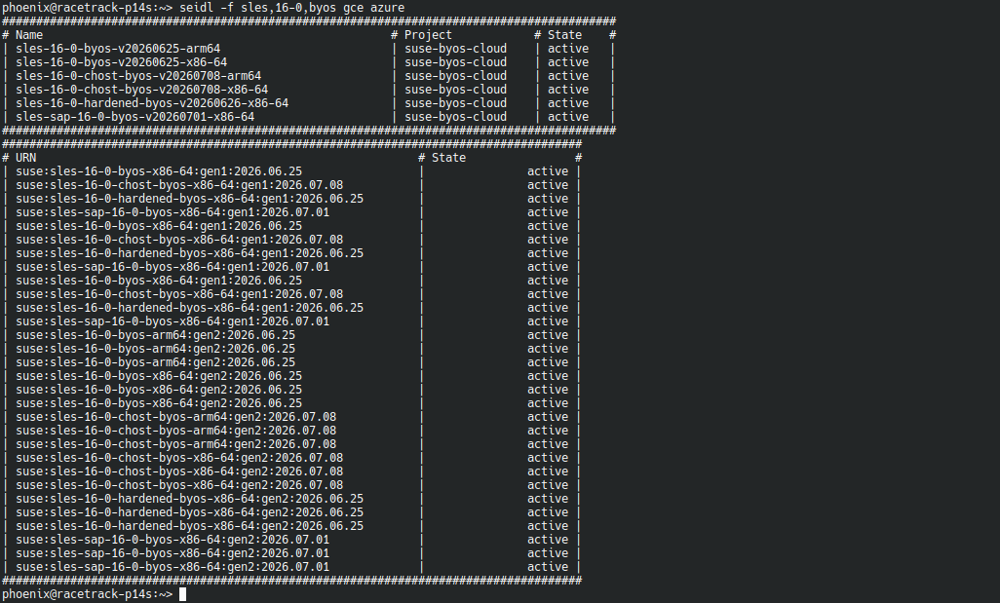

# seidl

`seidl` is a lightweight [pint](https://pint.suse.com/) query utility which
displays the current SUSE publiccloud images according to customizable filter
rules.

The primary goal is to provide a easy-to-use complement to
[public-cloud-info-client](https://github.com/SUSE-Enceladus/public-cloud-info-client),
more specifically to display all current images on the console.



Image information are fetched from
`https://susepubliccloudinfo.suse.com/v1/[microsoft|amazon|google]/images.json`.

`seidl` is named after a small beer quantity in Austria because it's slightly smaller than a pint.

## Usage

```
seidl -h                           # Print help

seidl gce                          # Query current GCE images
seidl --region eu-west-1 aws       # Query current AWS images
seidl azure                        # Query current Azure images
````

You can also filter results using the `-f` arguments. It supports a comma separated list of strings,
where every entry of that list must be present in the image name.

```
seidl -f sles,16-0 gce             # List GCE images, filter for SLES 15-SP3 images
seidl -f sles,15-sp7 azure gce     # List Azure and GCE images, filter for SLES 15-SP3 images
````

Additional commands are:

```
seidl --list-aws-regions           # List available AWS regions
seidl --list-az-envs               # List possible Azure environments
seidl --noformat ...               # Don't format the output as a table
```

## Install

Check the [Releases](https://github.com/grisu48/seidl/releases) page of this repository.

## openSUSE

`seidl` is part of openSUSE Tumbleweed and can be installed there via `zypper in seidl`.

Since at least Leap 16.0 it is also part of the main Leap repositories.

## Build

The lazy way:

```
make
make seidl install                 # the very lazy way. Build and install to ~/bin
```

The `go` way:

```
go build ./...
```

Requirements: Pure `go`, no external dependencies required.
